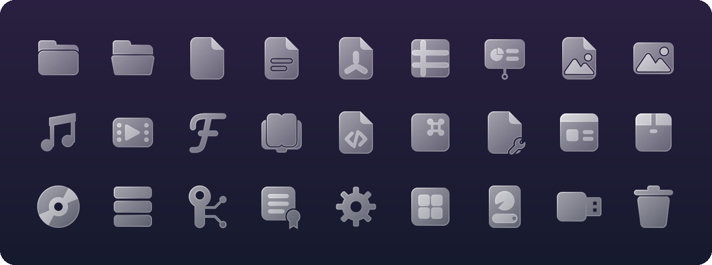

<div align="center">


# Shelf

**Файловый менеджер для Hyprland в стиле глассморфизма — на Qt 6 / QML**




</div>

---

## ✨ Зачем

Hyprland собирают ради красоты и скорости: размытие, анимации, цвета из обоев. А файловый менеджер
обычно приходит из чужого окружения — Thunar и Nautilus остаются GTK-приложениями, Dolphin —
KDE-приложением, и перекраска темы этого не прячет. Shelf сделан под Hyprland с нуля: отдельное
Wayland-приложение со своим `app_id` и `.desktop` (его можно назначить проводником по умолчанию),
которое выглядит частью рабочего стола, а не гостем на нём.

**Глассморфизм.** Окно из матового стекла: полупрозрачный фон, который Hyprland размывает своим
обычным `blur`, мягкие светлые кромки, плавные переходы и набор стеклянных иконок, нарисованный
специально для Shelf — папки приоткрываются при наведении, эмблемы на них наклоняются вместе со
стенкой. Отдельных правил в конфиге Hyprland не нужно; если размытие выключено, Shelf сам переходит
на сплошной фон.

**Цвета из обоев.** Палитру Shelf берёт у [matugen](https://github.com/InioX/matugen) — или у бара,
если он собран на Quickshell, — и перекрашивается вместе с ними при смене обоев, без перезапуска.
Нет ни того, ни другого — Shelf сам находит текущие обои (hyprpaper, swww, wpaperd, swaybg, waypaper) и
берёт оттенок из них. Иконки получают мягкий оттенок той же палитры.

**Готов из коробки.** При первом запуске Shelf проверит систему и подскажет, чего не хватает;
терминал, значки интерфейса и тема подбираются сами, без правки конфигов.

## 🧩 Возможности

- **Навигация** — сетка и список, история назад/вперёд, хлебные крошки с вводом пути, скрытые файлы
- **Вкладки** — у каждой своя папка, история и поиск; перетаскиваются мышью, средняя кнопка
  открывает папку в новой вкладке. После выключения компьютера или сбоя Shelf предложит вернуть вкладки
- **Перетаскивание** — внутри окна, между вкладками и в другие программы (браузер, мессенджер,
  терминал) и обратно; подержать файлы над папкой — она откроется
- **Боковая панель** — XDG-папки, закладки GTK (общие с Thunar и Nautilus), диски и флешки, корзина
- **Операции** — копирование, перемещение и вставка с прогрессом и отменой, переименование на месте,
  удаление в корзину, новая папка, окно свойств, «открыть в терминале», «открыть с помощью»
  (по `mimeapps.list`, с выбором приложения по умолчанию)
- **Окна выбора файлов** для других программ — открыть, сохранить, выбрать папку прямо в Shelf
  (свой бэкенд xdg-desktop-portal; Firefox, Chromium, Telegram, GTK- и Qt-программы)
- **Корзина** — восстановление на прежнее место, удаление навсегда, очистка; в списке видно,
  откуда и когда удалён файл
- **Буфер обмена** совместим с GNOME-приложениями (`x-special/gnome-copied-files`)
- **Поиск** — рекурсивный, в фоновом потоке, результаты приходят по мере нахождения
- **Миниатюры** картинок, видео, PDF и обложек аудио — из общего кэша `~/.cache/thumbnails`
  (тот же, что у Thunar и Nautilus); недостающие делает [tumbler](https://docs.xfce.org/xfce/tumbler/start) по D-Bus
- **Стеклянные иконки** — у каждого типа файла своя, папки приоткрываются при наведении,
  у стандартных папок и архивов — эмблемы из матового стекла. Мягкий оттенок из палитры:
  папки, документы и медиа — каждые своим цветом
- **Особые папки** — эмблемы у git-репозиториев, `~/Projects`, `.config` и `.local`;
  `node_modules`, `build`, `.cache` и прочие служебные папки приглушены
- **Значки** — стрелка у ссылок, замок у файлов без доступа или только для чтения
- **Логотипы языков** на файлах кода: Python, C/C++, Rust, Go, JS/TS, Qt/QML и ещё три десятка

## 🪟 Окна выбора файлов

Программы просят окно «Открыть / Сохранить» у xdg-desktop-portal, и Shelf умеет его рисовать:
в настройках (<kbd>Ctrl</kbd>+<kbd>,</kbd>) → «Проводник» → **Выбор файлов в окнах Shelf**.
Переключатель прописывает бэкенд в `~/.config/xdg-desktop-portal/hyprland-portals.conf` и
подключает `~/.config/hypr/shelf.conf`: там переменные, с которыми GTK-программы и Firefox тоже
спрашивают портал, и правило, чтобы окно выбора было плавающим и по центру. GTK-программы
подхватят это после перезапуска.

Бэкенд ставится с пакетами. При сборке в `~/.local` портал его не увидит — описание нужно
положить в системный каталог (Shelf покажет команду):

```sh
sudo install -Dm644 ~/.local/share/xdg-desktop-portal/portals/shelf.portal \
  /usr/share/xdg-desktop-portal/portals/shelf.portal
```

На NixOS: `xdg.portal.extraPortals = [ pkgs.shelf ];`.

## ⌨️ Горячие клавиши

| Клавиши | Действие |
|---|---|
| <kbd>Alt</kbd>+<kbd>←</kbd> / <kbd>Alt</kbd>+<kbd>→</kbd> | Назад / вперёд |
| <kbd>Alt</kbd>+<kbd>↑</kbd>, <kbd>Backspace</kbd> | Папка выше |
| <kbd>Ctrl</kbd>+<kbd>L</kbd> | Ввести путь |
| <kbd>Ctrl</kbd>+<kbd>F</kbd>, <kbd>/</kbd> | Поиск |
| <kbd>Ctrl</kbd>+<kbd>H</kbd> | Скрытые файлы |
| <kbd>Ctrl</kbd>+<kbd>1</kbd> / <kbd>Ctrl</kbd>+<kbd>2</kbd> | Сетка / список |
| <kbd>Ctrl</kbd>+колесо, <kbd>Ctrl</kbd>+<kbd>=</kbd> / <kbd>-</kbd> / <kbd>0</kbd> | Крупнее / мельче / обычный размер значков |
| <kbd>F2</kbd> | Переименовать |
| <kbd>Delete</kbd> | В корзину |
| <kbd>Ctrl</kbd>+<kbd>C</kbd> / <kbd>X</kbd> / <kbd>V</kbd> | Копировать / вырезать / вставить |
| <kbd>Ctrl</kbd>+<kbd>Shift</kbd>+<kbd>N</kbd> | Новая папка |
| <kbd>Ctrl</kbd>+<kbd>D</kbd> | В закладки |
| <kbd>Alt</kbd>+<kbd>Enter</kbd> | Свойства |
| <kbd>F4</kbd> | Терминал в текущей папке |
| <kbd>Ctrl</kbd>+<kbd>T</kbd> / <kbd>Ctrl</kbd>+<kbd>W</kbd> | Новая вкладка / закрыть вкладку |
| <kbd>Ctrl</kbd>+<kbd>Tab</kbd>, <kbd>Ctrl</kbd>+<kbd>PgDn</kbd> / <kbd>PgUp</kbd> | Следующая / предыдущая вкладка |
| <kbd>Alt</kbd>+<kbd>1</kbd>…<kbd>9</kbd> | Вкладка по номеру (<kbd>9</kbd> — последняя) |
| <kbd>Ctrl</kbd>+<kbd>,</kbd> | Настройки |
| <kbd>Ctrl</kbd>+<kbd>Q</kbd> | Закрыть окно |
| <kbd>F5</kbd>, <kbd>Ctrl</kbd>+<kbd>R</kbd> | Обновить |
| <kbd>F9</kbd> | Боковая панель |
| <kbd>Esc</kbd> | Отменить операцию / очистить поиск / снять выделение |

## 📦 Установка

**Fedora 43 и новее** — готовый пакет на странице [выпусков](https://github.com/nook-apps/shelf/releases):

```sh
sudo dnf install ./shelf-0.3.1-1.fc43.x86_64.rpm
```

Пакету нужен Qt 6.10 или новее, поэтому он ставится и на следующие выпуски Fedora.

**Debian 13, Ubuntu 25.04 и новее** — `.deb` на странице выпусков:

```sh
sudo apt install ./shelf_0.3.1_amd64.deb
```

**Arch Linux** — готовый пакет на странице выпусков или сборка из `PKGBUILD`:

```sh
sudo pacman -U ./shelf-fm-0.3.1-1-x86_64.pkg.tar.zst
# или
git clone https://github.com/nook-apps/shelf && cd shelf/packaging/arch && makepkg -si
```

В AUR пакет появится под именем `shelf-fm`.

**Nix / NixOS** — flake в этом репозитории:

```sh
nix run github:nook-apps/shelf             # попробовать, ничего не устанавливая
nix profile install github:nook-apps/shelf # поставить в профиль
```

В конфигурации NixOS — через оверлей:

```nix
# flake.nix системы
inputs.shelf.url = "github:nook-apps/shelf";
# в модуле
nixpkgs.overlays = [ inputs.shelf.overlays.default ];
environment.systemPackages = [ pkgs.shelf ];
```

Для миниатюр на NixOS включите `services.tumbler.enable = true;`.

Nix поверх другого дистрибутива (не NixOS): программам на OpenGL из Nix не видны драйверы
видеокарты системы, поэтому запускайте через [nixGL](https://github.com/nix-community/nixGL):

```sh
nix run --impure github:nix-community/nixGL -- nix run github:nook-apps/shelf
```

На других дистрибутивах — сборка из исходников, ниже.

## 🔧 Сборка из исходников

Для сборки нужны Qt ≥ 6.7 (Base, Declarative, Svg), CMake ≥ 3.21, Ninja и компилятор с C++20.

```sh
# Fedora
sudo dnf install qt6-qtbase-devel qt6-qtdeclarative-devel qt6-qtsvg cmake ninja-build gcc-c++
# Arch
sudo pacman -S qt6-base qt6-declarative qt6-svg cmake ninja

cmake -B build -G Ninja -DCMAKE_INSTALL_PREFIX=~/.local
cmake --build build
cmake --install build
```

Для работы:

| Что | Зачем | Обязательно |
|---|---|---|
| `gio` (glib2), `xdg-utils` | открывать файлы и запускать программы | да |
| терминал | «Открыть в терминале»: kitty, foot, alacritty, wezterm, ghostty, konsole, gnome-terminal или `xdg-terminal-exec` | желательно |
| [tumbler](https://docs.xfce.org/xfce/tumbler/start) | миниатюры картинок и PDF; без него — только уже готовые из кэша | нет |
| `ffmpegthumbnailer` | миниатюры видео (через tumbler) | нет |
| [matugen](https://github.com/InioX/matugen) | палитра Material из обоев (без него Shelf считает свою, попроще) | нет |

При первом запуске Shelf сам проверит, что есть, и подскажет команды установки для вашего
дистрибутива. Сам пакеты он не ставит.

Сделать Shelf проводником по умолчанию:

```sh
xdg-mime default io.github.nook_apps.Shelf.desktop inode/directory
```

> [!NOTE]
> Сборка ограничена четырьмя параллельными компиляторами (`JOB_POOLS` в `CMakeLists.txt`):
> каждый `cc1plus` с Qt занимает около 350 МБ, и на 16 ГБ с открытым браузером
> сборка по умолчанию (nproc + 2 задач) доводила систему до OOM.

## 🎨 Тема

Откуда брать цвета — в настройках (<kbd>Ctrl</kbd>+<kbd>,</kbd>) или при первом запуске.
«Автоматически» берёт первое найденное:

| Источник | Файл |
|---|---|
| Quickshell | `~/.local/state/quickshell/user/generated/qs_theme.json` |
| matugen — шаблон Shelf | `~/.local/state/shelf/colors.json` |
| Material из шелла (формат end-4) | `~/.local/state/quickshell/user/generated/colors.json` |
| из обоев | текущие обои hyprpaper, swww/awww, wpaperd, swaybg или из конфига waypaper / hyprpaper |
| встроенная светлая или тёмная | по `color-scheme` из xdg-desktop-portal |

Файлы отслеживаются: смена обоев перекрашивает открытое окно сразу. Палитру «из обоев» Shelf
считает сам: главный насыщенный оттенок картинки на светлотах встроенной темы, так что текст
читается на любых обоях; светлая или тёмная — по системной схеме. Обои проверяются раз в
четыре секунды, и только пока этот источник выбран.

**Подключить к matugen** можно из первой настройки: Shelf положит свой шаблон в
`~/.config/shelf/matugen/` и допишет блок `[templates.shelf]` в конец
`~/.config/matugen/config.toml` (перед этим — копия `config.toml.bak-shelf`). Сам matugen
Shelf не запускает: цвета появятся при следующей смене обоев.

**Стекло** — как в `~/.config/quickshell/settings.json`, если он есть, иначе включено, когда в
Hyprland включено размытие. Фон окна полупрозрачный, размывает его композитор (обычный `blur`,
отдельные правила не нужны). Своё стекло и плотность — в настройках.

## 🗂️ Структура

```
src/            C++: модель папки, файловые операции, места, тема, приложения, корзина,
                сессия, терминал, проверка окружения
qml/            интерфейс: окно, вкладки, боковая панель, сетка/список, иконки, диалоги
icons/          стеклянные SVG-иконки типов файлов
icons/emblems/  эмблемы стандартных папок и архивов (белые силуэты)
icons/lang/     логотипы языков программирования
icons/badges/   значки ссылки и замка
fonts/          вшитые символы значков интерфейса (из JetBrainsMono Nerd Font)
tools/          gen_icons.py — генератор иконок, preview_icons.py — превью набора,
                subset_icons.py — сборка шрифта значков
data/           шаблон .desktop-файла, иконка приложения, шаблон matugen
```

### Как рисуются иконки

Набор строит `tools/gen_icons.py`: фигуры описываются парой строк
(скруглённые прямоугольники, круги, линии), [shapely](https://shapely.readthedocs.io) объединяет
их и сам считает кромки и зазоры между предметами.

```sh
pip install shapely cairosvg pillow
python tools/gen_icons.py icons
python tools/preview_icons.py docs/icons.png   # картинка набора для README
```

Эмблемы и логотипы — плоские белые силуэты; матовое стекло на них накладывает
`qml/GlassEmblem.qml`. Новый логотип языка — это SVG в `icons/lang/` и одна строка
соответствия в `qml/FileIcon.qml`.

## 📜 Благодарности

- Стиль набора вдохновлён стеклянными иконками [Icons8](https://icons8.com); все SVG нарисованы
  заново генератором `tools/gen_icons.py`
- Логотипы языков — [Simple Icons](https://simpleicons.org) (CC0); чашка Java нарисована отдельно
- Значки интерфейса — из [JetBrainsMono Nerd Font](https://www.nerdfonts.com) (OFL / MIT),
  вшиты в программу (`fonts/`)

## 📄 Лицензия

Shelf распространяется под [GNU GPL v3](LICENSE) или более поздней версией (GPL-3.0-or-later).

- Шрифт значков `fonts/` — SIL Open Font License 1.1 (`fonts/OFL.txt`), значки Nerd Fonts — MIT / OFL
- Логотипы языков в `icons/lang/` — CC0 ([Simple Icons](https://simpleicons.org))
